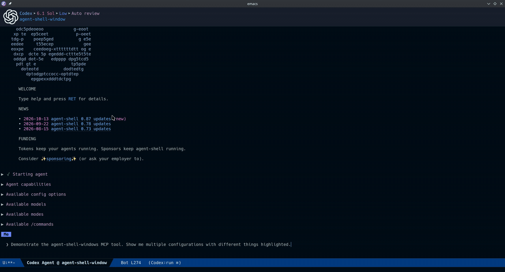

# agent-shell-windows

Let an agent show you files adjacent to the agent-shell in Emacs.



## Prerequisites

- Emacs 29.1+
- [web-server](https://github.com/eschulte/emacs-web-server) 0.1.2+
- [agent-shell](https://github.com/xenodium/agent-shell) 0.95.1+ with an agent that supports HTTP MCP

## Install

```elisp
(use-package agent-shell-windows
  :straight (:type git :host github :repo "strutt/agent-shell-windows")
  :demand t)
```

## What it does

From inside agent-shell, the agent can show you files in Emacs. Up to
3 agent-shell-windows are grouped into a static layout with the
agent-shell buffer. The agent controls what files are shown, the
viewport and can highlight regions.

Ask it to walk you through the code it's written or images, it's a
nice experience!

If you dismiss the windows for any reason, `agent-shell-switch-buffer`
and `agent-shell-toggle` will restore window layout.


## Some useful functions

`agent-shell-windows-stop` disables agent control of
agent-shell-windows for the current conversation, leaving its existing
windows in place and the MCP server running for other
agents. `agent-shell-windows-start` re-enables. New conversations are
enabled automatically.


## How it works

I don't trust agents enough to give them routine access to my
credentials or my Emacs. Emacs contains the keys to my kingdom. To
avoid using emacsclient, agent-shell-windows starts a local web server
on http://localhost:8765/mcp. The server limits that agent to opening
existing files in those windows within the session's working directory.

Agents that aren't in containers have access to your cli. Their
commands use YOUR credentials. They'll promise they would never, ever
delete your production database. Better not to give them the
option... put them in a container.

agent-shell supports containers. If you launch it with
`host.docker.internal` available you can let it use
agent-shell-windows by setting the advertised URL. You can do this via
`.dir-locals.el`:

```elisp
((nil . ((agent-shell-windows-mcp-url
          . "http://host.docker.internal:8765/mcp"))))
```

You'll also need to allow container traffic on port 8765 and tell the
web-server (in emacs) to listen to the Docker bridge address. Add the
docker bridge IP to `agent-shell-windows-http-hosts`. By default it
only listens on localhost (127.0.0.1).

```elisp
(setq agent-shell-windows-http-hosts
      '("127.0.0.1" "172.17.0.1"))
```

`172.17.0.1` is an example. Replace it with your host's Docker bridge
address.
